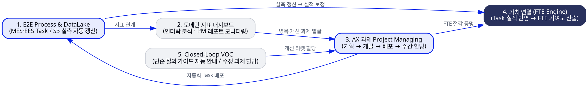

# 🗺️ 중장기 로드맵 — 반도체 Fab AX 전주기 운영 및 인력 가치 플랫폼

<!-- 이 문서 하나가 앱의 **🗺️ 로드맵** 화면 원본이에요. `## ` 제목 하나가 화면의 탭 하나가 되고, `> **🏭 현장 적용 시나리오**`로 시작하는 인용 블록은 파란 시나리오 박스로, ` ```dot ` 블록은 다이어그램으로 그려져요. 이 파일만 고치고 새로고침하면 화면에 반영돼요. -->

## 플랫폼 비전

**"단순 인력 계산기를 넘어, 반도체 AX 전주기 운영 및 인력 가치 연결 플랫폼으로"**

지금의 시뮬레이터는 "AX와 파트 묶음을 적용하면 FTE가 얼마나 확보되는가"를 계산해요. 앞으로는 그 앞뒤를 이어서, 현장 업무 하나가 **데이터로 측정되고 → 개선 과제가 되고 → 배포되어 → FTE 기여도로 검증되고 → 다시 현장 의견으로 돌아오는** 닫힌 루프(Closed-Loop)를 만드는 게 목표예요.

**현장 업무(Task) → 데이터 파이프라인(DataLake/S3) → 과제 PM(기획~배포) → 실적 보정 → FTE 기여도 검증(시뮬레이터 엔진) → 현장 VOC 피드백 → 다시 현장 업무**

### 전체 순환 구조



- **블루 테두리** = 새로 만들 핵심 축(E2E·과제 PM), **네이비** = 지금 있는 시뮬레이터 엔진, **회색** = 연결 축이에요.
- 실측값은 지금처럼 **실적 보정**(입력값과 실측값 비교 → 사람이 확인 → (입력) 자동화율 반영)을 거쳐 FTE 계산에 들어가요. 자동 수집이 되어도 이 확인 단계는 남겨요.

## 🔄 E2E & DataLake

### 축 1. 소분류 업무별 E2E Process Flow & DataLake 자동 실측 파이프라인

**핵심 목적** — 지금은 소분류 업무의 빈도·건당 시간을 사람이 조사해서 넣어요. 소분류를 이루는 세부 Task와 사내 시스템을 연결해 두면, 시스템 로그로 빈도와 시간을 자동으로 잴 수 있어요.

**아키텍처**

| 단계 | 내용 |
|---|---|
| ① Task 분해 | 소분류 1개 = 세부 Task 여러 개. 각 Task의 앞뒤 순서와 담당 시스템(MES · EES · FDC · YMS 등)을 정의해요 |
| ② 로그 쿼리 | Task마다 "실행됐다"를 알 수 있는 시스템 로그를 DataLake에서 매일 쿼리해요 |
| ③ S3 적재 | 쿼리 결과(건수, 시작·종료 시각)를 S3에 배치로 쌓아요 |
| ④ 실측 갱신 | 파트 × 소분류 × 연도별로 모아 기준정보 **(실측) 빈도 · (실측) 건당 소요시간**을 자동으로 채워요 |
| ⑤ 실적 보정 | 입력값과 차이가 큰 줄을 사람이 확인하고 (입력) 자동화율에 반영해요 (지금 있는 화면) |

> **🏭 현장 적용 시나리오 (Fab Use Case)** — "포토설비 알람 원격 리셋" 소분류
>
> 1. **Task 1** · FDC가 실시간 알람을 감지해요.
> 2. **Task 2** · MES에서 해당 Lot의 레시피 인터락을 확인해요.
> 3. **Task 3** · EES로 원격 파라미터 리셋 명령을 보내요.
>
> 매일 DataLake에서 EES 리셋 명령 로그를 쿼리해 S3에 쌓아요. 연간 합계가 **1,200건/년**으로 모이면 기준정보의 (실측) 빈도가 1,200건으로 자동 갱신되고, 실적 보정 화면에 "입력 900건 vs 실측 1,200건" 차이가 떠서 담당자가 확인해요.

**상세 기능**

- 소분류별 Task 흐름도 편집기 (Task · 담당 시스템 · 앞뒤 관계)
- Task ↔ 로그 쿼리 매핑과 일 배치 스케줄
- (실측) 열 자동 갱신 + 갱신 이력, 수집 실패 알림

**기대 효과**

- 업무 조사에 드는 시간을 줄이고, 매년 하던 조사를 상시 측정으로 바꿔요.
- 빈도가 실제로 늘고 있는지(원류 업무 증가)와 자동화로 시간이 줄었는지를 데이터로 나눠 볼 수 있어요.

**관련 KEEP (SPEC 13장)** — 주기적 실적 관리(원류 제어율) · 업무 빈도 예측 고도화

## 📈 지표 대시보드 (인터락/PM)

### 축 2. 공정·설비 지표 대시보드 & E2E 연계

**핵심 목적** — 엔지니어가 매일 보는 현장 품질·설비 지표를 한 화면에 모으고, 축 1의 E2E Task와 바로 연결해서 "어느 Task가 병목인지"를 지표로 확인해요.

**주요 레포트**

| 레포트 | 보는 것 |
|---|---|
| **인터락(Interlock) 분석** | 설비 · 챔버 · 레시피별 인터락 발생 빈도, 평균 해소 시간, 해소에 들어간 공수 |
| **PM(예방정비) 모니터링** | 정기 PM 준수율, 기준 시간 대비 초과 시간, 자동화 후보 Task 발굴 |

**연계 방식** — E2E 흐름도에서 Task를 누르면 그 Task의 인터락·PM 통계 대시보드가 함께 열려요. 해소 시간이 긴 Task가 곧 AX 과제 후보예요(→ 축 3).

> **🏭 현장 적용 시나리오 (Fab Use Case)** — 식각 챔버 인터락 병목
>
> 인터락 분석 레포트에서 식각 챔버 B 레시피의 인터락이 월 140건, 평균 해소 25분으로 다른 레시피의 2배예요. E2E 흐름도에서 "인터락 원인 확인" Task를 누르면 해소 시간의 60%가 MES 이력 조회에 쓰이고 있어요. 이 Task가 **"인터락 원인 자동 요약"** AX 과제 후보로 등록돼요.

**상세 기능**

- 설비 · 챔버 · 레시피 단위 드릴다운, 기간 비교
- PM 계획 대비 실적, 초과 시간 순위
- Task 연결 버튼 (지표 → E2E Task → AX 과제 등록)

**기대 효과**

- 업무량(시간)과 설비 지표(인터락 건수 · PM 시간)를 같은 단위로 연결해, 인당 관리 챔버 수만으로는 안 보이던 부하 원인을 설명할 수 있어요.

**관련 KEEP (SPEC 13장)** — 설비 지표 연결 · 업무량과 설비 대수 연결 · 물리 라인 정보 · 파트별 설비 정보 매핑

## 📋 AX 프로젝트 매니징

### 축 3. AX 과제 프로젝트 매니지먼트 (기획 → 배포 → FTE 실기여도)

**핵심 목적** — AX 과제의 기획 · 개발 · 평가 · 배포 전체를 관리하고, 파트원의 주간 업무(스프린트)로 나눠 배정해요. 과제마다 **어느 소분류 업무의 자동화율을 얼마나 올리는지**를 연결해 두면, 배포한 과제가 실제로 FTE를 얼마나 확보했는지 시뮬레이터 엔진으로 바로 계산할 수 있어요.

**가치 연결 사슬 (Value Chain)**

| 단계 | 예 |
|---|---|
| 과제 등록 | "포토 챔버 인터락 자동 해소 에이전트 개발" — 대상 소분류와 목표 자동화율을 함께 적어요 |
| 주간 할당 | 담당 파트원 배정, WBS 진척도 관리 |
| 배포 · 실적 연계 | 배포하면 대상 소분류의 자동화율 목표(예: 80%)가 업무구분 시트의 그해 목표에 반영돼요 |
| FTE 영향 | 연간 절감 공수와 FTE 확보 기여도를 시뮬레이터가 계산해요 |

> **🏭 현장 적용 시나리오 (Fab Use Case)** — 포토 챔버 인터락 자동 해소 에이전트
>
> 배포 후 대상 소분류의 자동화율이 목표 80%에 도달해 연간 업무시간이 **1,500시간** 줄었어요.
>
> - **오피스 업무**라면: 1,500h ÷ 1인 연간 가용시간(2,080h − 연차·교육·식사·휴식, 샘플 기준 약 1,510h) ≈ **FTE +1.0 확보**
> - **교대 업무**라면: 시간이 줄어도 근무대 **자리가 하나 줄어야** FTE가 줄어요. 자리 1개 = 8h × 365 ÷ 1인 가용(약 1,900h) ≈ **1.5 FTE** 단위로 계단식으로 확보돼요. 묶음 운영과 같이 보면 효과가 커져요.
>
> 과제 카드에 이 값이 실시간으로 표시돼서 "이 과제가 FTE를 얼마나 만들었는지"를 바로 증명할 수 있어요.

**상세 기능**

- 과제 보드(기획 · 개발 · 평가 · 배포), 과제 ↔ 소분류 매핑
- 주간 스프린트 배정과 진척도(WBS)
- 과제별 목표 vs 실적 자동화율, 절감 공수, FTE 기여도

**기대 효과**

- AX 목표 자동화율이 "그냥 적은 숫자"가 아니라 과제 일정과 연결된 근거 있는 목표가 돼요.

**관련 KEEP (SPEC 13장)** — AX 과제(프로젝트) 관리

## 💬 Closed-Loop VOC

### 축 4. 현장 VOC 창구 & Closed-Loop 피드백

**핵심 목적** — 현장에서 나오는 질문과 개선 요청을 한 창구로 받고, 답이 있는 건 바로 답하고, 고쳐야 하는 건 과제로 넘겨 끝까지 추적해요.

| 단계 | 처리 방식 |
|---|---|
| **1단계 · Self-Service** | 단순 기능 질문 · 사용법 문의는 📖 가이드 / FAQ 검색이 바로 답해요 |
| **2단계 · Closed-Loop** | 계산 로직 수정 · 오류 제보 · 기능 개선 요구는 티켓(Issue)으로 등록 → 담당 개발 파트원의 주간 업무로 배정(→ 축 3) → 배포가 끝나면 요청한 사람에게 결과를 알려요 |

> **🏭 현장 적용 시나리오 (Fab Use Case)** — "우리 파트 GY 최소 인원이 왜 2명이죠?"
>
> 파트원이 VOC 창구에 질문을 남기면 가이드의 "최소 인원" 설명과 인원 시트 입력 위치가 바로 안내돼요(1단계). 이어서 "물리 업무가 없어진 GY는 1명으로 계산해 달라"는 요청을 남기면 티켓으로 등록되어 담당자 주간 업무에 들어가고, 기준정보 수정이 반영되면 요청자에게 알림이 가요(2단계).

**상세 기능**

- 가이드 · FAQ 검색과 자동 답변
- 티켓 등록 · 분류(질문 / 오류 / 개선) · 담당 배정 · 상태 추적
- 배포 완료 알림, 자주 나오는 질문의 FAQ 자동 추가

**기대 효과**

- 같은 질문이 반복되지 않고, 현장 의견이 실제 개선으로 이어졌는지 추적할 수 있어요.

## 🚀 단계별 추진 계획

| 단계 | 이름 | 주요 내용 | 상태 |
|---|---|---|---|
| **Phase 1** | 기반 확립 | FTE 시뮬레이터 완성, 기준정보 5개 시트 정규화, 가이드 문서화 | 🔵 진행 중 (샘플 완료) |
| **Phase 2** | 과제 & E2E | 소분류 E2E Process Flow 정의, AX 과제 기획-배포 PM 보드 구축 | ⚪ 예정 |
| **Phase 3** | 데이터 파이프라인 | DataLake 쿼리 & S3 연계 파이프라인, 인터락 / PM 모니터링 대시보드 | ⚪ 예정 |
| **Phase 4** | 선순환 완성 | 실측치 기반 FTE 실기여도 자동 검증, Closed-Loop VOC 운영 체계 확립 | ⚪ 예정 |

> **🏭 현장 적용 시나리오 (Fab Use Case)** — Phase가 끝날 때마다 달라지는 것
>
> - **Phase 1 후**: 파트장이 "AX 목표대로 가면 우리 파트 FTE가 얼마나 확보되는지"를 화면에서 바로 봐요.
> - **Phase 2 후**: 그 목표 자동화율이 어떤 과제로 달성되는지, 누가 언제 하는지 보여요.
> - **Phase 3 후**: 빈도와 시간을 조사 대신 시스템 로그로 재요.
> - **Phase 4 후**: 배포된 과제가 만든 FTE가 실측으로 검증되고, 현장 의견이 다시 과제로 돌아와요.

- 지금 저장소는 **사내 구축 전 샘플**이에요. Phase 2부터는 사내(DevOps)에서 실제 시스템(MES · EES · FDC · YMS · DataLake)과 연결하며 만들어요.
- 단계별 세부 항목은 SPEC.md 13장(KEEP)과 함께 관리해요.
